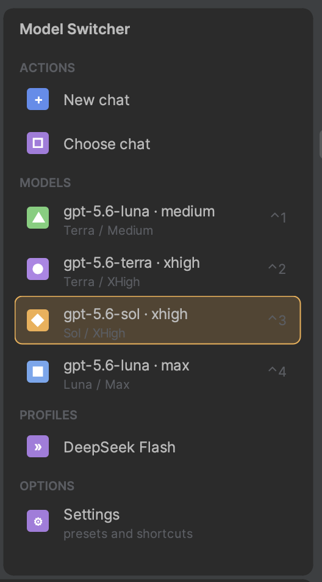
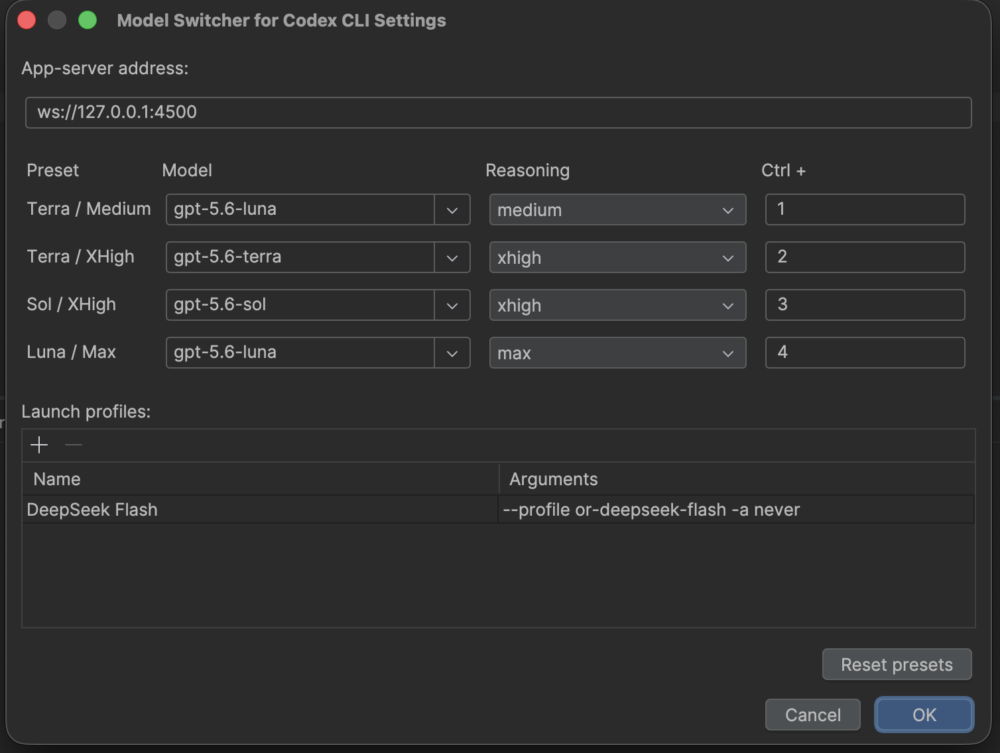

# Model Switcher for Codex CLI

[](https://plugins.jetbrains.com/plugin/33507-model-switcher-for-codex-cli)
[](https://plugins.jetbrains.com/plugin/33507-model-switcher-for-codex-cli)
[](https://plugins.jetbrains.com/plugin/33507-model-switcher-for-codex-cli)
[](LICENSE)

An IntelliJ IDEA tool window for [Codex CLI](https://github.com/openai/codex): switch the model and reasoning effort
of every active chat in one click, jump straight to a saved chat, and launch your own Codex profiles — without
leaving the IDE or typing shell commands.

<p align="center">
  
  &nbsp;&nbsp;&nbsp;
  
</p>

## Features

- **Model presets** — four configurable model/reasoning slots, each with its own keyboard shortcut. Switching a
  preset updates every currently open Codex chat at once through the local Codex app server.
- **Chats** — open a new chat with the current preset, or pick any saved chat from a searchable list and resume it
  in an integrated terminal.
- **Launch profiles** — for anything outside the model presets (a named Codex CLI profile, a non-default flag
  combination, whatever `~/.codex/config.toml` knows about), add a launch profile in Settings: give it a name and
  the extra arguments to pass, e.g. `--profile my-profile`. It shows up as its own button in the tool window.
- **Per-project isolation** — every open project gets its own Codex app-server process and port, so a "New chat"
  in one project window never ends up rooted in another project's directory.
- **Local and verified only** — the plugin only ever launches the Codex executable found at
  `/opt/homebrew/bin/codex` or `/usr/local/bin/codex`, authenticates the local app server with a capability token
  generated fresh on every start, and never sends keystrokes to the editor.

## Requirements

- macOS
- IntelliJ IDEA 2026.2 or newer (build `262+`)
- [Codex CLI](https://github.com/openai/codex) installed at `/opt/homebrew/bin/codex` or `/usr/local/bin/codex`

## Installation

**From the JetBrains Marketplace** (recommended): in IntelliJ IDEA, go to
`Settings/Preferences → Plugins → Marketplace`, search for **Model Switcher for Codex CLI**, and click **Install**.
Or install directly from the [plugin page](https://plugins.jetbrains.com/plugin/33507-model-switcher-for-codex-cli).

**From source:**

```bash
git clone https://github.com/RomanBatrakov/codex-model-switcher.git
cd codex-model-switcher
./gradlew buildPlugin
```

The built plugin ZIP lands in `build/distributions/`. Install it via
`Settings/Preferences → Plugins → ⚙ → Install Plugin from Disk…`.

## Usage

1. Open the **Model Switcher** tool window (right sidebar).
2. Click a **MODELS** card, or use its keyboard shortcut, to apply that model/reasoning preset to every open Codex
   chat.
3. Click **New chat** to start a chat with the current preset in the project's own directory, or **Choose chat** to
   resume a saved one.
4. Add **launch profiles** in Settings for anything a preset doesn't cover — they show up as their own buttons in
   the tool window.

## Security notes

- The app server binds to a loopback address only (`127.0.0.1`/`localhost`); public or remote addresses are
  rejected.
- Each server run generates a random capability token, stored in an owner-only file, and passed to the Codex
  process without ever being exported to the whole terminal session.
- Chat identifiers are validated as full UUIDs and shell-escaped before touching a terminal command.

See [AGENTS.md](AGENTS.md) for the full set of project and security rules this codebase follows.

## License

[MIT](LICENSE) — see the [LICENSE](LICENSE) file.

*Independent tool built to work with Codex CLI. Not affiliated with or endorsed by OpenAI.*
